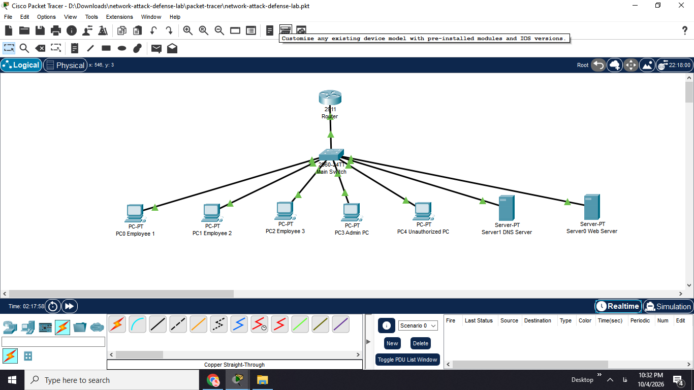

```markdown
# Network Attack & Defense Lab

A small network security lab built with Cisco Packet Tracer.

This project was created as a hands-on networking and cybersecurity project. The main goal was to build a small organizational network, separate different types of devices using VLANs, test network access, and use an Access Control List (ACL) to control unauthorized traffic.

## Project Overview

The network represents a small organization with four different network segments:

- Employees
- Servers
- Administration
- Untrusted devices

The project was built in Cisco Packet Tracer using a Cisco 2911 router and a Cisco 2960 switch.

I first configured the network and tested connectivity between the different VLANs. At this stage, the Unauthorized-PC was able to reach the Web-Server.

After confirming that the basic network connectivity was working, I added an extended ACL to restrict traffic coming from the untrusted network.

The main idea was to keep normal communication working while preventing an unauthorized device from accessing sensitive parts of the network.

## Network Topology

The network has the following logical structure:

```text
                         Router
                       Cisco 2911
                           |
                         Trunk
                           |
                     Main-Switch
                           |
       ------------------------------------------------
       |              |              |               |
    VLAN 10         VLAN 20        VLAN 30         VLAN 40
   Employees        Servers         Admin          Untrusted
       |              |              |               |
   Employee-1     Web-Server      Admin-PC      Unauthorized-PC
   Employee-2     DNS-Server
   Employee-3
```



## VLAN Design

The network is divided into four VLANs:

| VLAN | Name      | Network          | Purpose              |
|------|-----------|------------------|----------------------|
| 10   | EMPLOYEES | 192.168.10.0/24  | Employee devices     |
| 20   | SERVERS   | 192.168.20.0/24  | Web and DNS servers  |
| 30   | ADMIN     | 192.168.30.0/24  | Administrator device |
| 40   | UNTRUSTED | 192.168.40.0/24  | Untrusted device     |

## Devices

The lab contains:

- 1 Cisco 2911 Router
- 1 Cisco 2960 Switch
- 3 Employee PCs
- 1 Admin PC
- 1 Unauthorized PC
- 1 Web Server
- 1 DNS Server

## IP Addressing

### VLAN 10 - Employees

| Device      | IP Address      | Default Gateway |
|-------------|-----------------|-----------------|
| Employee-1  | 192.168.10.10   | 192.168.10.1    |
| Employee-2  | 192.168.10.11   | 192.168.10.1    |
| Employee-3  | 192.168.10.12   | 192.168.10.1    |

### VLAN 20 - Servers

| Device      | IP Address      | Default Gateway |
|-------------|-----------------|-----------------|
| Web-Server  | 192.168.20.10   | 192.168.20.1    |
| DNS-Server  | 192.168.20.11   | 192.168.20.1    |

### VLAN 30 - Administration

| Device    | IP Address     | Default Gateway |
|-----------|----------------|-----------------|
| Admin-PC  | 192.168.30.10  | 192.168.30.1    |

### VLAN 40 - Untrusted

| Device            | IP Address     | Default Gateway |
|-------------------|----------------|-----------------|
| Unauthorized-PC   | 192.168.40.10  | 192.168.40.1    |

## Router-on-a-Stick Configuration

The connection between the router and the switch is configured as a trunk.

The router uses subinterfaces for the four VLANs:

```text
interface GigabitEthernet0/0.10
 encapsulation dot1Q 10
 ip address 192.168.10.1 255.255.255.0

interface GigabitEthernet0/0.20
 encapsulation dot1Q 20
 ip address 192.168.20.1 255.255.255.0

interface GigabitEthernet0/0.30
 encapsulation dot1Q 30
 ip address 192.168.30.1 255.255.255.0

interface GigabitEthernet0/0.40
 encapsulation dot1Q 40
 ip address 192.168.40.1 255.255.255.0
```

This configuration allows the router to route traffic between the different VLANs.

## Switch Configuration

The switch was configured with four VLANs:

```text
VLAN 10 - EMPLOYEES
VLAN 20 - SERVERS
VLAN 30 - ADMIN
VLAN 40 - UNTRUSTED
```

The switch ports were assigned as follows:

| Port  | Device           | VLAN |
|-------|------------------|------|
| Fa0/1 | Router           | Trunk |
| Fa0/2 | Employee-1       | 10 |
| Fa0/3 | Employee-2       | 10 |
| Fa0/4 | Employee-3       | 10 |
| Fa0/5 | Admin-PC         | 30 |
| Fa0/6 | Unauthorized-PC  | 40 |
| Fa0/7 | Web-Server       | 20 |
| Fa0/8 | DNS-Server       | 20 |

The router connection on Fa0/1 is configured as a trunk:

```text
interface FastEthernet0/1
 switchport mode trunk
```

## Security Scenario

The Unauthorized-PC represents a device that should not have access to sensitive network segments.

Before applying any access control, the device was able to communicate with the Web-Server.

For example:

```text
Unauthorized-PC
192.168.40.10
       |
       |
192.168.40.1
       |
     Router
       |
192.168.20.1
       |
Web-Server
192.168.20.10
```

The successful ping showed that the network was allowing communication between the untrusted VLAN and the server VLAN.

This gave me a simple baseline before applying the security rule.

## ACL Configuration

I created an extended ACL on the router to block traffic from the untrusted network to the server and admin networks.

```text
access-list 140 deny ip 192.168.40.0 0.0.0.255 192.168.20.0 0.0.0.255
access-list 140 deny ip 192.168.40.0 0.0.0.255 192.168.30.0 0.0.0.255
access-list 140 permit ip any any
```

The ACL was applied inbound on the VLAN 40 router subinterface:

```text
interface GigabitEthernet0/0.40
 ip access-group 140 in
```

The first rule blocks traffic from the untrusted network to the server network.

The second rule blocks traffic from the untrusted network to the admin network.

The final rule allows other traffic that is not specifically blocked by the ACL.

## Connectivity Testing

I tested the network before and after applying the ACL.

### Before Applying the ACL

#### Unauthorized-PC → Web-Server

Source: `192.168.40.10`

Destination: `192.168.20.10`

Result: **Successful**

The Unauthorized-PC was able to reach the Web-Server.

This showed that, before adding the ACL, devices in the untrusted VLAN could access the server network.

### After Applying the ACL

#### Unauthorized-PC → Web-Server

Result: **Blocked**

Packet loss: **100%**

The ACL blocked traffic from the untrusted VLAN to the server VLAN.

#### Unauthorized-PC → Admin-PC

Result: **Blocked**

Packet loss: **100%**

The ACL also prevented the unauthorized device from reaching the admin network.

#### Employee-1 → Web-Server

Result: **Successful**

Packet loss: **0%**

Employee traffic to the server was still working after the ACL was applied.

#### Admin-PC → Web-Server

Result: **Successful**

Packet loss: **0%**

The admin device could still communicate with the Web-Server.

## Test Results

| Source            | Destination | Before ACL | After ACL |
|-------------------|-------------|------------|-----------|
| Unauthorized-PC   | Web-Server  | Allowed    | Blocked   |
| Unauthorized-PC   | Admin-PC    | Allowed    | Blocked   |
| Employee-1        | Web-Server  | Allowed    | Allowed   |
| Admin-PC          | Web-Server  | Allowed    | Allowed   |

These tests show that the ACL was working as intended for the traffic that I wanted to restrict.

## Before and After

### Before ACL

The Unauthorized-PC could reach the Web-Server.

```text
Unauthorized-PC
       |
       v
    Router
       |
       v
  Web-Server

     ALLOWED
```

### After ACL

The Unauthorized-PC could no longer reach the Web-Server or Admin-PC.

```text
Unauthorized-PC
       |
       v
    Router
       X
       |
       v
Web-Server / Admin-PC

     BLOCKED
```

At the same time, legitimate traffic from the Employee and Admin networks continued to work.

## Project Structure

```text
network-attack-defense-lab/
│
├── README.md
│
├── topology/
│   └── network-topology.png
│
├── configs/
│   ├── router-config.txt
│   └── switch-config.txt
│
├── tests/
│   └── connectivity-tests.md
│
└── packet-tracer/
    └── network-attack-defense-lab.pkt
```

## Files

### `network-topology.png`

A screenshot of the final Packet Tracer topology.

### `router-config.txt`

The running configuration of the Cisco 2911 router.

### `switch-config.txt`

The running configuration of the Cisco 2960 switch.

### `connectivity-tests.md`

The connectivity tests performed before and after applying the ACL.

### `network-attack-defense-lab.pkt`

The Cisco Packet Tracer project file containing the complete network lab.

## Tools Used

- Cisco Packet Tracer
- Cisco IOS CLI
- VLANs
- Router-on-a-Stick
- Extended ACLs
- IPv4
- Git
- GitHub
- Markdown

## What I Learned

Through this project, I practiced several networking and security concepts.

I learned how to create VLANs and assign switch ports to different network segments.

I also learned how router-on-a-stick works and how a router can provide communication between multiple VLANs using subinterfaces.

Another important part of the project was understanding how ACLs can be used to control traffic between different networks.

The before-and-after tests helped me understand the effect of an ACL more clearly because I could see the same traffic being allowed before the rule and blocked after applying it.

## Limitations

This project is a simulated network lab created in Cisco Packet Tracer.

The unauthorized access scenario is simulated using an Unauthorized-PC. It is not a real penetration test or a real-world attack.

The ACL only blocks the specific traffic defined in the rules. It does not provide complete protection against every possible type of unauthorized network activity.

## Future Improvements

Some possible improvements for this project would be:

- Add more ACL rules for different types of traffic.
- Add DHCP instead of manually assigning IP addresses.
- Configure the DNS server and test name resolution.
- Add a firewall between the internal network and the Internet.
- Add logging and monitoring for blocked traffic.
- Add more realistic attack scenarios in a controlled lab environment.

## Conclusion

This project helped me understand how basic network segmentation and access control can improve the security of a small organization.

I started with a working network where the Unauthorized-PC could reach the Web-Server. I then separated the network using VLANs and applied an extended ACL to restrict access from the untrusted network.

The final tests showed that the unauthorized traffic was blocked while legitimate employee and administrator traffic continued to work.

Overall, this project gave me practical experience with VLANs, inter-VLAN routing, ACLs, network troubleshooting, and basic network security concepts.

## Author

**Saina Gooran**

Computer Engineering Student
```